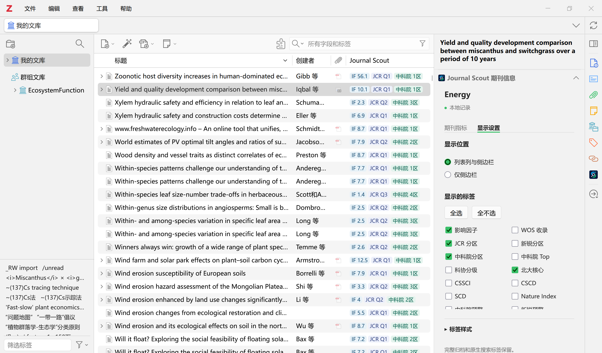

  
  <h1>Journal Scout for Zotero</h1>
  

    
    
    
    
  

在 Zotero 文献列表与右侧面板中查看、归档和筛选期刊指标及 CCF 会议等级。

  <a href="#这是什么">这是什么</a> ·
  <a href="#能做什么">能做什么</a> ·
  <a href="#开始使用">开始使用</a> ·
  <a href="#你会得到什么">你会得到什么</a> ·
  <a href="#使用边界">使用边界</a> ·
  <a href="#进阶参考">进阶参考</a>

## 这是什么

Journal Scout for Zotero 是 ScanSci 发布的 Zotero 插件，适合希望在自己的文献库中查看期刊分区、比较影响因子和筛选会议等级的研究者。

查到的指标会归档到条目中，后续优先读取本地记录和期刊缓存。网站发布数据版本后，插件优先更新当前查看的文献，让查询结果随文献积累。

## 能做什么

| 你想做的事 | 插件提供的方式 |
| --- | --- |
| 浏览文献时查看期刊与会议等级 | 在 Journal Scout 列和右侧面板显示影响因子、五年影响因子 IF5、JCR 分区、中科院分区、Top、CCF、中文核心等指标 |
| 按指标筛选文献 | 在高级搜索中选择独立的 Journal Scout 指标；IF 与 IF5 分别按数值比较，条件可组合并保存 |
| 保存已经查到的指标 | 自动写入条目 Extra（附加信息），复用本地归档与期刊缓存 |
| 只展示自己关心的信息 | 逐项选择显示指标，切换「列表列与侧边栏」或「仅侧边栏」，调整配色、字号、圆角和间距 |
| 补全已有文库 | 在设置中按需补全文库期刊指标，查看进度或取消，保留已完成的归档 |
| 获取后续更新 | 插件版本通过 Zotero 原生更新机制分发，指标数据通过网站的数据版本信号更新 |

## 开始使用

当前版本为 **v0.1.1**。安装清单声明支持 **Zotero 7–10**；已在 **10.0.8** 实测，7–9 尚未逐版测试。Zotero 6 不支持。

1. 从[发行页](https://github.com/Rimagination/journal-scout-zotero/releases/latest)或[官网安装页](https://journal.scansci.com/extension-install.html#zotero-install)下载 `.xpi` 安装包。

2. 在 Zotero 中打开「工具 → 插件」。

   

3. 点击插件管理器右上角齿轮，选择「从文件安装插件 / Install Plugin From File」，打开下载的 `.xpi` 文件。

   

4. 安装后选中一篇文献，在 Journal Scout 列或右侧面板查看指标。Windows 下可在「编辑 → 设置 → Journal Scout」中调整显示选项。

2026-11-13 同版本修订增加 IF5；已安装 v0.1.1 的用户需重新下载 XPI 并覆盖安装。官方「<0.1」保持为范围值，不按精确 0.1 比较。

后续更新遵循 Zotero 插件管理器中的自动更新设置。需要立即检查插件新版本时，点击齿轮菜单「检查更新 / Check for Updates」。

## 你会得到什么

### 随条目保存的指标

已确认的指标存入条目 Extra，插件同时维护用于兼容原生筛选的标签，保留已有 Extra 正文和用户标签。这些条目修改可以随 Zotero 同步，并可能包含在部分导出文件中。

若要补全整个文库，打开「设置 → Journal Scout → 补全文库期刊指标」。操作覆盖当前文库及其收藏夹，可查看进度并取消；已完成的归档会保留。日常浏览会优先处理当前文献，无需反复刷新。

### 按数值和分级筛选

在 Zotero 高级搜索的字段菜单中选择 **Journal Scout → 影响因子、五年影响因子 IF5、中科院分区、JCR 分区或 CCF 等指标**。例如选择「影响因子 → 大于 → 10」，可筛选已归档影响因子大于 10 的文献。

IF 与 IF5 支持完整小数的**等于、不等于、大于、小于**比较，缺失值不按 0 处理。可与 Zotero 其他条件组合，并保存搜索。筛选读取本地归档，执行时需要启用插件。

Zotero 原生「标签」条件也保留兼容用途，例如「标签 → 包含 → 北大核心」。下图展示原生标签筛选；数值比较使用上面的 Journal Scout 指标字段。

### 按习惯调整的显示方式

在显示设置中勾选需要展示的指标，选择「列表列与侧边栏」或「仅侧边栏」，并调整标签配色、字号、圆角和间距。显示设置保存在本机，隐藏某项指标不会删除已经归档的数据。

## 使用边界

- **查询内容**：期刊查询使用条目已有的刊名或 ISSN，会议等级按会议名称匹配 CCF 目录；不上传论文全文或附件。
- **数据完整性**：未收录或无法确认的指标保留为空。指标可能缺失或存在更新延迟，使用时请核对对应年度及原始来源。
- **条目修改**：自动归档会修改 Extra 和插件管理的原生标签，可能随 Zotero 同步及出现在部分导出文件中；只读或正在编辑的条目会跳过。
- **兼容范围**：安装清单的支持范围与逐版实测范围见「开始使用」。本仓库用于发布安装包与使用说明。

## 进阶参考

| 入口 | 内容 |
| --- | --- |
| [官网安装指南](https://journal.scansci.com/extension-install.html#zotero-install) | 下载入口与图文操作步骤 |
| [发行版本](https://github.com/Rimagination/journal-scout-zotero/releases) | 安装包与各版本更新说明 |
| [问题反馈](https://github.com/Rimagination/journal-scout-zotero/issues) | 安装、匹配、显示及筛选问题 |
| [Journal Scout 官网](https://journal.scansci.com/) | 在线查询与产品信息 |
| [原生更新清单](https://journal.scansci.com/updates/zotero.json) | Zotero 插件版本更新入口 |
| [数据版本信号](https://journal.scansci.com/data/zotero-data-release.json) | 网站发布的指标数据版本信息 |
